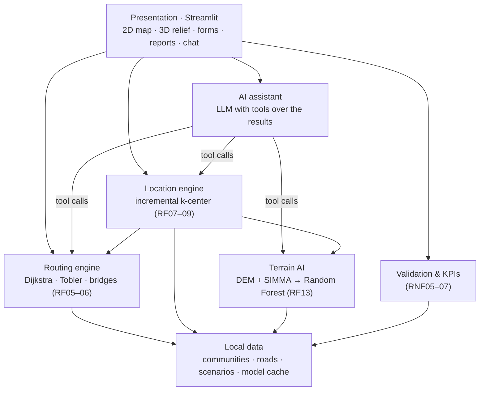

# ACCESO

**Equitable location of rural health and education centers using real travel distances, AI terrain assessment and a conversational assistant.**


ACCESO is a web application that proposes where to build new rural health posts, schools and hospitals. It is aligned with the UN 2030 Agenda's **Sustainable Development Goal 10 (Reduced Inequalities)**.

It works in four steps:

1. It measures distances over the **real road network and relief**, not in straight lines.
2. It prioritizes the **most remote community**: it minimizes the worst trip, not the average.
3. It discards **unsuitable terrain** with a Random Forest classifier: steep slopes, landslides, riverbanks and páramo.
4. It explains every decision through an **AI assistant** that only cites figures computed by the engine.

Case study: **Provincia de La Libertad** (Paya, Pisba, Labranzagrande and Pajarito) in Boyacá, Colombia. Paya and Pisba are among the most marginalized municipalities of the department.

> Classroom project for the course **Diseño de Datos y Algoritmos (DDYA)**, Escuela Colombiana de Ingeniería Julio Garavito, 2026.
> 📄 Full paper (Spanish): [`paper/Paper_ACCESO_DDYA.pdf`](paper/Paper_ACCESO_DDYA.pdf)

---

## Table of contents

- [Key results](#key-results)
- [Features](#features)
- [Tech stack](#tech-stack)
- [Architecture](#architecture)
- [Repository structure](#repository-structure)
- [Getting started](#getting-started)
- [AI assistant setup](#ai-assistant-setup)
- [Testing](#testing)
- [Deployment](#deployment)
- [Authors](#authors)
- [References](#references)

---

## Key results

These figures come from simulations on synthetic rural networks (see [docs/RESULTS.md](docs/RESULTS.md)):

| Indicator | Target | Paper | Latest local run |
|---|---|---|---|
| Worst-distance reduction vs. most populated communities (N1) | ≥ 20 % | **26.4 %** | 29.7 % |
| Centers on unsuitable terrain avoided by the AI (N4) | 0 % proposed | 23.9 % avoided | 33 % avoided |
| Placement time for k = 5 centers (T1) | ≤ 2 s | 78.8 ms (V = 50 000) | 29.4 ms (V = 10 000) |
| Road-closure recompute (T3) | ≤ 1 s | 10.3 ms | 13.5 ms |
| Approximation factor vs. optimum (T4) | ≤ 2, mean ≤ 1.5 | 1.46 mean / 1.95 max | 1.28 mean / 1.82 max |
| Terrain classifier, spatial CV (T8) | AUC ≥ 0.85 | – | AUC 0.953, recall 0.894 |

In the La Libertad scenario, ACCESO cuts the worst trip to a health center from 142.6 min to 86.6 min, a 39 % reduction.

---

## Features

### 🗺️ Map and centers

- 2D map on OpenStreetMap with the proposed centers, the communities each center serves, and the real route versus the straight line.
- Elevation profile of the longest trip.
- Fixed (existing) centers.
- Two travel modes: walking, or vehicle on road plus walking.
- Two criteria: travel time with slopes, or 3D distance.

### ⛰️ 3D relief

Interactive terrain surface colored by altitude, slope or AI suitability, with rivers, roads and routes.

### 🧠 Terrain AI

- Random Forest trained on slope, altitude, curvature, topographic position index (TPI) and distance to rivers.
- Validated with spatial block cross-validation.
- Includes a confusion matrix, feature importances and a per-cell explanation.

### ⚖️ Strategy comparison

ACCESO compared against:

- the most populated communities
- random placement
- ACCESO without terrain AI
- the paper's rules without refinement
- maximum coverage (RF12)

### 🚧 Road closures

Close any road or bridge and the scenario is recomputed in milliseconds (user story HU-04).

### 💬 AI assistant

Answers questions in natural language, for example *"why is center 3 there?"* or *"what if this bridge falls?"*. It calls the engine as **tools** and verifies every figure in the answer against the engine output (a retrieval-augmented approach). It works with:

- **LM Studio**, local and offline
- any **OpenAI-compatible cloud API**
- a **guided mode** with no language model at all

### 📊 KPI audit

Reproduces Table II of the paper: business KPIs N1–N6 and technical KPIs T1–T11. Includes a Lighthouse guide, a SUS questionnaire and a CSV export.

### 📋 Data

Browse and download the settlements, roads and synthetic SIMMA landslide inventory, and export the scenario as JSON.

> The user interface and the assistant speak **Spanish**, since the target users are municipal planners in Colombia. All source code is written in English.

---

## Tech stack

| Layer | Technology | Use |
|---|---|---|
| Language | **Python 3.11+** | Whole application (tested on 3.14) |
| Web UI | **Streamlit** (`st.navigation`, `st.cache_resource`, fragments) | Multipage web app, caching, chat interface |
| Visualization | **Plotly** (`Scattermap`, `Surface`, `Scatter3d`) | 2D maps, 3D relief, charts |
| Numerical computing | **NumPy**, **SciPy** (`scipy.sparse.csgraph.dijkstra`, `cKDTree`, `Delaunay`) | Sparse graphs, shortest paths, spatial indexing, synthetic networks |
| Machine learning | **scikit-learn** (`RandomForestClassifier`), **joblib** | Terrain suitability classifier and model cache |
| Graphs | **NetworkX** | Synthetic road network (minimum spanning tree plus extra links) |
| Data | **pandas** | Tables, KPIs, CSV export |
| LLM client | **openai** Python SDK | Connects to LM Studio or any OpenAI-compatible endpoint with tool calling |
| Local LLM | **LM Studio** (e.g. Qwen2.5 7B Instruct, Qwen3 4B) | Offline assistant |
| Testing | **unittest**, Streamlit `AppTest` | Automated test suite |

### Algorithms

| Algorithm | Use |
|---|---|
| **Incremental k-center** ("farthest-first", Gonzalez 1985) | Center placement. It is a 2-approximation and runs Dijkstra only from the chosen centers: O(k(V+E) log V) time and O(V) memory. |
| **Dijkstra** | Shortest paths over a grid graph of the relief. |
| **Tobler's hiking function** | Walking speed by slope. |
| **Center refinement** | Moves each center to the most central suitable point of its group. |
| **Maximum coverage** | Alternative criterion (RF12). |
| **Random Forest + spatial cross-validation** | Terrain suitability: suitable, conditional or unsuitable. |

---

## Architecture



The assistant **queries the engines and never computes on its own**, so it cannot make up figures.

---

## Repository structure

```text
ACCESO_REPO/
├── src/                     Application source code
│   ├── main.py              Entry point: navigation and lazy loading
│   ├── config.py            All parameters: territory, terrain rules, center types, KPI targets, LLM
│   ├── data_generator.py    Synthetic DEM, rivers, SIMMA landslides, villages and road network
│   ├── terrain_ai.py        3-class Random Forest with spatial cross-validation (T8)
│   ├── routes.py            Relief graph (Tobler, bridges, vehicle) and road closures
│   ├── k_centers.py         Incremental k-center, refinement, maximum coverage, brute-force optimum
│   ├── scenarios.py         Orchestrator: scenarios, KPIs, routes, strategy comparison
│   ├── ai_assistant.py      LLM assistant: LM Studio / cloud / guided mode, tools, figure verification
│   ├── kpi_audit.py         Table II tests (N1–N6, T1–T11)
│   └── ui_components.py     Streamlit pages
├── tests/                   Automated test suite (unittest)
├── docs/
│   ├── TESTING.md           How to run and what each test covers
│   └── RESULTS.md           Paper results and latest local run
├── paper/
│   └── Paper_ACCESO_DDYA.pdf
├── .streamlit/
│   ├── config.toml
│   └── secrets.toml.example
├── requirements.txt
└── README.md
```

---

## Getting started

### Requirements

- Python 3.11 or newer
- About 1 GB of free RAM

No internet connection is needed to run the core application.

### Installation

```bash
git clone https://github.com/DonJuanBruh/ACCESO_REPO.git
cd ACCESO_REPO
python -m venv .venv
```

Activate the virtual environment:

```bash
# Windows
.venv\Scripts\activate
# macOS / Linux
source .venv/bin/activate
```

Install the dependencies and start the app:

```bash
pip install -r requirements.txt
streamlit run src/main.py
```

The app opens at `http://localhost:8501`. Other devices on the same network, such as a town hall's computers, can use the **Network URL** that Streamlit prints.

The first launch generates the territory and trains the terrain model. This takes a few seconds, and the model is then cached in `src/acceso_cache/`.

---

## AI assistant setup

The assistant picks the first available provider:

1. **LM Studio (local, offline)**
   - Install [LM Studio](https://lmstudio.ai/) and download a model that supports tool calling, for example *Qwen2.5 7B Instruct* or *Qwen3 4B*.
   - Go to **Developer** → **Start Server** (port 1234).
   - In the app, open **Asistente IA** → **Probar conexión**.
2. **Cloud model (optional)**
   - Copy `.streamlit/secrets.toml.example` to `.streamlit/secrets.toml` and fill in your values.
   - This file is git-ignored and must never be committed.

   ```toml
   ACCESO_CLOUD_URL = "https://api.openai.com/v1"
   ACCESO_CLOUD_API_KEY = "your-key"
   ACCESO_CLOUD_MODEL = "model-name"
   ```

   The same values can be set as environment variables. `ACCESO_LM_STUDIO_URL` and `ACCESO_LM_STUDIO_MODEL` are also supported.
3. **Guided mode:** with no model available, the chat answers from templates filled in by the engine.

---

## Testing

```bash
python -m unittest discover -s tests -t . -v
```

The suite has 35 tests covering the data generator, terrain AI, routing, k-center (including the 2-approximation bound against brute force), scenarios, KPIs and the assistant. Each module also has a self-test (`cd src && python k_centers.py`).

See [docs/TESTING.md](docs/TESTING.md) for details and [docs/RESULTS.md](docs/RESULTS.md) for the latest results.

---

## Deployment

To get a stable public link, deploy to **Streamlit Community Cloud**:

1. Push this repository to GitHub.
2. Create a new app with `src/main.py` as the main file.
3. Optionally, paste the cloud-model keys under **Secrets**.

On the cloud the assistant uses the cloud model or the guided mode, because LM Studio only exists on your own computer.

---

## Authors

| Name | Role | GitHub |
|---|---|---|
| _Author 1_ | _Role_ | [@username](https://github.com/username) |
| _Author 2_ | _Role_ | [@username](https://github.com/username) |
| _Author 3_ | _Role_ | [@username](https://github.com/username) |
| _Author 4_ | _Role_ | [@username](https://github.com/username) |

Course: Diseño de Datos y Algoritmos (DDYA), Escuela Colombiana de Ingeniería Julio Garavito.

---

## References

Key sources from the paper:

- T. F. Gonzalez, "Clustering to minimize the maximum intercluster distance," *Theor. Comput. Sci.*, 1985.
- D. S. Hochbaum and D. B. Shmoys, "A best possible heuristic for the k-center problem," *Math. Oper. Res.*, 1985.
- E. W. Dijkstra, "A note on two problems in connexion with graphs," *Numerische Mathematik*, 1959.
- L. Breiman, "Random forests," *Machine Learning*, 2001.
- J. P. Ospina-Gutiérrez and E. Aristizábal, AI for landslide susceptibility in the Colombian Andes, *Rev. Mex. Cienc. Geol.*, 2021.
- D. J. Weiss et al., "Global maps of travel time to healthcare facilities," *Nature Medicine*, 2020.
- P. Lewis et al., "Retrieval-augmented generation for knowledge-intensive NLP tasks," *NeurIPS*, 2020.

See the [paper](paper/Paper_ACCESO_DDYA.pdf) for the full list of 27 references.
